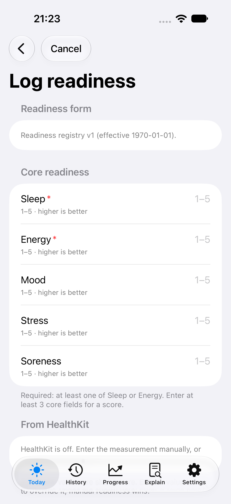
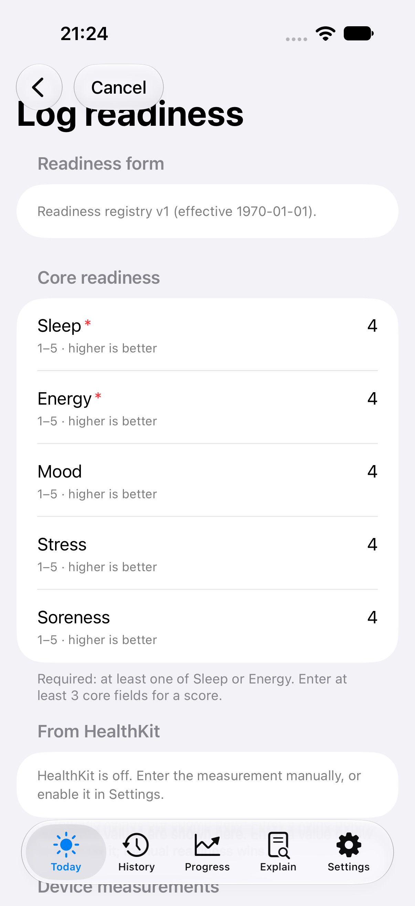
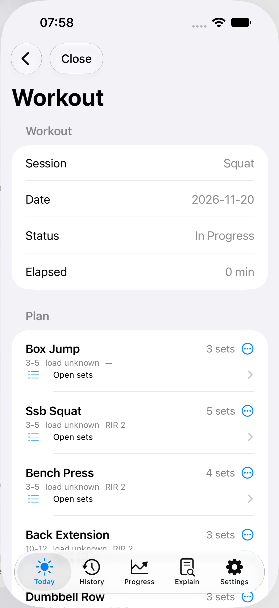
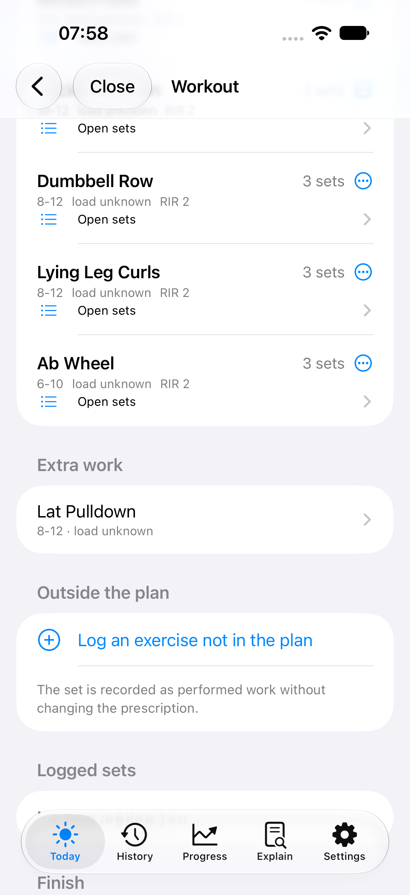

# StrengthApp — iPhone user guide

This is the owner-facing guide for the native iPhone client. The server, web UI and training
engine are documented separately in the
[strength-training-app docs](https://github.com/georgesdib/strength-training-app/blob/development/docs/README.md).

## 1. What the app does

StrengthApp is a companion for one local strength-coach server. Python remains the authority for
readiness scoring, prescriptions, loads, sets, e1RM, volume and training decisions. The phone
displays those results and records what actually happened during a workout.

The core loop is:

1. Review readiness and today's prescription.
2. Start the workout on the phone.
3. Record each set and the rest between working sets.
4. Finish the workout with session RPE and optional notes.
5. Review the completed session and progress.

The app is not a cloud service and does not replace the server's training rules.

## 2. Before pairing

You need:

- the server running strength-coach web and reachable from the phone;
- an iOS 27.0 or newer iPhone;
- a build signed for your phone (the personal-team build expires after seven days);
- a one-use pairing code from the server.

The server may be reached over the trusted home LAN, or through a private HTTPS address such as
Tailscale Serve. Do not expose the unauthenticated web server to the public Internet.

### Pairing

On the server, run from the server checkout (the default database is `data/coach.db`):

    strength-coach ios pair --label "iPhone"

Use `--db` for another database, e.g. `strength-coach --db /path/to/coach.db ios pair`; if the
tool is not on `PATH`, call it as `.venv/bin/strength-coach`. It prints the code once, grouped
as 4+4 digits, with its expiry:

    pairing code: 1234 5678
    expires at:   2026-11-11T23:15:00+00:00 (300s)
    device label: iPhone (enter it in the app if it differs)

Enter the code in the app's pairing screen, choose a label and pair. The token is stored in the
iPhone Keychain and the server keeps only its SHA-256 digest. The code is single-use and expires
after five minutes; `--ttl 60-3600` changes the lifetime.

Manage credentials with `strength-coach ios devices` (device ids, last-seen times) and
`strength-coach ios revoke <device-id>`. Revoking a device also revokes the watches that paired
through it.

If pairing fails:

- check the code was copied exactly and has not expired;
- check the address from the phone, not only from the computer;
- use HTTPS for a Tailscale/MagicDNS address; plain HTTP is for the trusted LAN only.

## 3. Home and Away servers

Settings has:

- **Home Server** — usually the LAN address;
- **Away Server** — usually a private Tailscale/HTTPS address;
- **Prefer Home Server** — the manual preference.

With Prefer Home Server on, the app makes a short reachability check against Home and uses Away
when Home does not answer. Turn it off to force Away when configured. The choice is saved when
you tap **Save server settings**.

Both addresses should normally point at the same paired server/database. Changing to a different
server may require pairing again. A Tailscale HTTPS URL should use the MagicDNS hostname, not a
raw 100.x address.

## 4. Daily workout flow

1. Open **Today** and review readiness and the prescription. A **Review** card may show one
   coaching nudge at a time (for example a scheduled deload or an active competition window);
   **Snooze 14 days** or **Dismiss** records the decision on the server, and the card returns when
   the underlying state changes. The read-only **Programme** card
   shows the trained week, the DUP cycle, the deload status with its calendar week, and the
   competition date/countdown. Trained week and deload week are different definitions: trained
   weeks count only weeks with a session, while the deload calendar counts every week since the
   block anchor.
2. When requesting a new workout, the plan belongs to the iPhone/watch pairing. It appears on
   both devices and either device can start it.
   The main-lift structure offers **Server default**, **Prefer top set + back-off**,
   **Require top set + back-off** or **Straight sets**. Preferred accepts a straight-set fallback
   with a recorded reason; required marks an unexpected fallback as unsatisfied, but the plan stays
   startable. **Technique throttle (main work)** asks the server to lighten main-work loads for
   this session only; the issued plan marks the affected exercises and explains why. The server
   owns eligibility and every load.
3. When the plan is ready, open **Review workout** to see every exercise, target set, rep range,
   load, RIR, any velocity target, rest and any warnings. **Start workout** is on that screen, so the plan is always
   visible before it is consumed. The server issues the plan; the phone never invents plan content.
4. Open an exercise and tap **Start set** before the set. The first set starts the exercise;
   the exercise stays open until you end it, and starting a set in another exercise leaves the
   first one open, which is how a superset is recorded.
5. Enter load, reps and RIR. When the plan gives the lift a velocity target, it is shown beside
   RIR on the phone and the watch; optional mean and per-rep velocity are offered, and bodyweight
   work is not asked for them. The rest
   is anchored at your **first edit** of the sheet, so the time you spend entering numbers is rest,
   not part of the set; the set keeps the time you started it.
6. Each main lift lists its warm-up ramp, starting with the empty bar (the first rung is capped
   at 20 kg, or the first warm-up when that is lighter). Warm-up rows are optional: skipping them
   and logging the working sets is valid. To record one, tap **Start set** on its warm-up row: it
   fills that row's load and reps, and RIR 6 is what records the set as a warm-up.
   A working set starts the rest timer automatically; logged warm-ups (RIR 6) do not.
7. A saved set has **Edit**: saving appends one correction and keeps the set's server identity.
   **Remove set** is a separate action; it never resurrects or re-adds a set.
8. Repeat for the remaining sets and exercises. If the server becomes unreachable after a
   plan has been downloaded, **Start workout** still starts it: the plan's execution id and your
   start time are kept locally and bound on the next sync. When an exercise is done, tap **End exercise**:
   it closes any running rest, records the exercise's completion and offers the optional 1–5 form
   rating. Leaving the screen does not end the exercise.
9. Finish with session RPE or **Not recorded**, optional duration/notes and productivity.
10. Review the **Session report** that opens after completion: prescription adherence, velocity,
   session feedback, quality flags and evidence. It is read-only. If the Apple Watch still owes
   sets, the report says **Apple Watch data pending** and refreshes until the server settles the
   window; do not treat those totals as final until then. **Done** returns to Today.
11. The same report is available later from the session's **History** detail. An imported session
    with no workout record explains that no report exists.

### Logging readiness

**Today → Log readiness** renders the server's effective readiness registry: only enabled metrics,
in the registry's order, with its labels, 1–5 scales, units and direction. A red **\*** marks the
fields named by the registry's required-one-of rule (normally sleep or energy). The form checks
the minimum number of core fields before it submits, but that check is a convenience: the server
still validates every value, and any field error it returns is shown on the matching input.

Bodyweight and the wearable score are separate, non-registry inputs and are sent with the
readiness values. HealthKit HRV, resting heart rate and bodyweight are shown on the same form; a
manual value wins.

The app caches the last schema it received. If the server is unreachable, the form uses that
cached schema, or the fixed seeded fields when no cache exists, and says so at the top. A metric
added to the server registry after the cache was written cannot be entered offline; the app does
not invent a value for it, and it appears after the next successful sync.

### Substituting and adding work

A plan item with more than one target group (for example a top set and a back-off) lists each
group as its own target line, in order, on the phone and on the watch. The logging sheet
prefills the next group by the number of working sets already recorded, and the last group holds
beyond the plan.

The plan is frozen when the workout starts. The **⋯** menu on a plan row offers the two
mid-session changes:

- **Substitute exercise…** replaces that plan slot for this session. It is available only
  before any set is recorded for the slot; after that the menu is disabled, because the
  replacement never takes over a partly completed slot. The performed sets stay attributed to
  the slot, the phone and watch show the substitute, and the watch labels it **Changed on
  phone**.
- **Add extra work after…** adds work after that slot. It appears under **Extra work**, is
  selectable on the phone and watch, and its sets are recorded as extra work without a plan
  slot.

The phone applies the server-built catalogue's prefill, including the live erector dose and set
cap, and shows it on both devices. The phone never invents a load: a catalogue miss stays blank
and is never replaced by the original exercise's load. The change is applied locally before the
server answers; if the phone is offline it stays **Saved on this iPhone** and syncs later. If the
server rejects it, the row stays visible as **Unresolved** rather than silently reverting.

### Set controls

- **Start set** records when you began the set.
- Saving records the completion time and actual set duration.
- The performed set remains the canonical load/reps/RIR/velocity record.
- Removing a set records the correction; it does not rewrite history.
- Unplanned exercises and repeated occurrences of the same exercise are supported.

### Rest timer

The timer uses the prescription's rest seconds when available.

- It displays prescribed rest and counts down above the tab bar, on Today and every other tab,
  so leaving the workout does not hide it.
- **Skip** ends the rest early.
- **+15 s** extends the timer.
- Starting the next set also ends the current rest.
- When rest finishes, the timer dismisses itself and the app records the actual interval.
- The interval survives a relaunch: a rest that ended while the app was closed is recorded at the
  time it actually ended, not when the app next opened.

### Lock Screen and Control Center

The phone shows one Live Activity card for the whole workout on the Lock Screen and in the Dynamic
Island. During a rest it shows the countdown; between rests it shows the active state, **Next set
on iPhone** or **Next set on Apple Watch**. The countdown is drawn by the system from the rest's end
time, so it stays correct with the app closed. **+15 s** and **Skip** are buttons on a phone-owned
rest; a rest owned by the Apple Watch shows **Rest on Apple Watch** instead, because the wrist owns
the interval and ends it. The compact Island shows the timer only.

iOS only lets a Live Activity *start* while the app is in the foreground, so a workout running on
the Apple Watch uses one extra step for the first rest:

- if the phone app is not open, the phone posts a **Rest on Apple Watch** notification instead of
  starting the card, and the notification is replaced at each rest until a card exists;
- tap the notification (or its **Show countdown** action) to open the app and start the workout
  card, anchored to the rest's original end time so the countdown is correct even if the tap was
  late;
- after that the card stays for the workout and later rests, extensions and skips update it in the
  background with no further taps or notifications;
- if the app is already open when the watch reports a rest, the card starts directly;
- the card ends when the workout finishes or is abandoned, and a phone-owned rest takes precedence
  over a watch rest.

The card is not a substitute for the watch: the wrist still shows and ends its own rest. If
notifications are denied, the phone has no way to prompt you, but the watch notification and the
watch screen still work.

Settings → Control Center (or the Action button) can host the **Strength** control. It opens the
running workout; it does not record a set or change a rest on its own.

The timer is descriptive. It does not change the next prescription or declare the session
compliant.

### Rest alerts

The first rest timer asks for notification permission. If allowed, the app schedules a local
notification for the rest end. The same permission lets a watch rest alert the phone when it
cannot start the workout card:

- the notification plays the system sound and follows the phone's vibration/silent settings;
- it carries a **Done** action; tapping either the action or the notification opens the app and
  clears the alert (it does not yet deep-link directly into the active workout);
- extension reschedules the notification;
- skip/finish cancels it.

While the app is active, completion also uses an in-app haptic and sound. If notifications are
denied, the in-app timer still works. If the app is force-quit, the timer state is lost and no
rest-completion event is fabricated.

## 5. Offline use

The app keeps the active workout and pending operations on the phone before acknowledging them.

- Sets, form ratings, finish operations and execution events can be queued.
- The exercise catalogue is cached on the phone: the library and exercise pickers remain usable
  offline. Substitutions and additions are applied locally and queued; other plan edits still
  require the server.
- Queued work survives app termination and reloads on the next launch.
- Replay preserves the original occurrence time.
- The app shows pending, offline and conflict states rather than claiming server acceptance.
- A workout with pending work cannot silently switch to another server address.
- Finish flushes pending execution events first.
- Unresolved work remains visible; it is not silently discarded or attached to another workout.
- If the local recovery file cannot be read, Today shows **Offline recovery** with a retry action.
  Offline writes are paused and the file is preserved until you retry or explicitly discard it.
- If recovered work belongs to a different active workout, **Offline recovery conflict** asks you
  to keep the current workout and discard the recovered work, or use the recovered workout.
- A failed local capture write is shown as **Offline capture write failed**; it is not reported as
  a network error.
- If execution timing could not be recorded while recovery was unavailable, Today and the workout
  screen show **Execution timing** rather than silently dropping it.

Fresh readiness scoring, prescription generation and server authority are not available offline.
Readiness entry itself still works: the form uses its cached schema (or the fixed seeded fields),
the attempted write is journaled like the other Phase 2 mutations, and the authoritative score
refreshes when the server confirms it. Offline records are performed-work capture, not a new
prescription.

## 6. History and execution timeline

Completed sessions in **History** show:

- the session facts, sets and duration;
- a recorded execution section when execution events exist;
- active lifting, recorded rest, transition and total elapsed time;
- set durations;
- prescribed versus actual rest and deviation;
- a chronological event timeline;
- missing-timestamp indicators.

Older or imported sessions without execution events show that the timeline is unavailable. The
app does not invent starts, ends or rest periods. These are observations, not fatigue, readiness
or compliance scores.

The server's web UI **History → Details** shows the same read-only execution timeline for
completed workouts.

## 7. Progress and Exercise Library

- **Progress** shows the server's descriptive dashboard: sRPE coverage, performance points,
  weekly volume, attendance and back-symptom summary over the selected window.
- **Progress → Weekly review** shows the server's deterministic Monday–Sunday package: activity,
  adherence, sessions, main-lift progression, volume, readiness coverage, programme state and up to
  two gated observations, with coverage and limitations. It is read-only and has no model; an empty
  week says so instead of showing zeros.
- **Settings → Exercises** provides a searchable catalogue, exercise configuration, server e1RM
  and paginated working-set history.
- Catalogue/configuration is cached for the app session; entering an exercise fetches e1RM and
  history, and explicit refresh controls are available.

Exercise information is read-only. The training rules and prescription engine are unchanged.

### Siri and Shortcuts

Siri answers the app's read-only training questions — training overview, last workout, average
workout duration, weekly review and one exercise's progression — on the iPhone and Apple Watch.
On the phone, the same actions appear in the Shortcuts app, and each one returns the sentence it
speaks as its output, so a shortcut can pass the answer to a later action, display it, or branch
on it. **Start Workout** and **Finish Workout** return their status message in the same way; they
also open the app, where the workout is started or finished by hand.

## 8. HealthKit

HealthKit readiness is optional and off by default. When enabled, the app reads only:

- heart-rate variability (SDNN) — readiness uses a **recovery value per night**: the median of
  that day's readings taken before 10:00. A morning with no reading has no HRV for that day; a
  daytime reading is kept for the record but does not drive readiness;
- resting heart rate;
- bodyweight.

Manual readiness takes precedence over HealthKit, which takes precedence over imported
readiness. The app never writes to HealthKit and does not import sleep. The recovery series is
backfilled once from Health (up to five years) and then updated nightly; the import runs on an app
refresh and after enabling HealthKit.

A separate, opt-in activity sync sends the workouts, workout heart rate, active energy, VO₂max
estimates, steps per day and sitting time the app reads from Health. Steps and sitting travel as
**one value per completed calendar week (Monday to Sunday)**: the phone averages those seven days
and sends the mean, because both are periodic assessments rather than daily state. Sitting is derived as 24 hours
minus Apple Watch stand time, so it only exists for days a watch was worn — an iPhone-only athlete
records no sitting value at all, which is missing rather than zero. Neither value changes a load,
a prescription or a readiness score.

**Workout heart rate is read only on Apple Watch**, for the live session display. The watch saves
one HealthKit workout for a session it ran; the phone saves one when it finishes a session, so a
session finished on both can leave two. The app never deletes or merges them, and training data
still comes from the server's recorded sets.

## 9. Settings and maintenance

- **Home/Away server** — addresses and preference.
- **Exercise Library** — catalogue and history.
- **Apple Watch** — pair, replace or revoke the watch credential.
- **HealthKit** — opt-in readiness import.
- **Daily reminder** — one nudge a day at a time you choose.
- **Today summary** — the two-part prose block at the top of Today.
- **Forget this device** — removes the local token; the server-side device record is managed
  separately with the server CLI.

### Today summary

The top of **Today** can carry a short block in two parts: **Where you stand**, a plain summary of
your readiness and the session in front of you, and **Nudge**, a line or two of encouragement. It uses
the same model you selected for Chat: Apple Intelligence on the iPhone, or DeepSeek.

With DeepSeek selected, loading the card sends your readiness and four-week training facts to DeepSeek.
Plan details travel only while **Include plan and prescription data** is on. The footer under the card
always names the model that wrote it, so you can tell at a glance where the words came from. If the
selected model is unavailable — Apple Intelligence off, or no DeepSeek key saved — the card says so and
offers nothing else; it never quietly switches to the other model. **Refresh** rewrites it; otherwise it
is generated once per day and session and reused. Turn the whole block off under
**Settings → Today summary**.

The aerobic and fitness facts — the last completed week against the WHO band, this week's progress
and the latest VO₂max — are loaded from your server and shown without any model. With DeepSeek
selected they are sent only while **Include health measurements** is on; on-device generation needs
no consent. VO₂max is shown with its value, units, date, source and a **current**, **stale** or
**absent** state; a missing reading is not evidence of poor fitness. A week above 300
moderate-equivalent minutes is described as **above** the reference band, never as excessive. The
chat uses the same health consent: with it off, the model cannot receive or call the longevity tool.

### Daily reminder

Turn on **Settings → Daily reminder** and choose a time. At that time the app posts one local
notification that names a concrete fact from your record — a planned session, its lead lift and load,
or a missing readiness entry — and asks you to train. The wording is written on the iPhone: by Apple
Intelligence when it is available, otherwise from the built-in text. Nothing is sent to a server.

A readiness entry with too few answers to form a score is not treated as done: the reminder asks
you to finish it, and tapping it opens the readiness form.

The reminder is skipped on a day you have already trained. If you train on the watch only and never
open the phone, the phone cannot see the session, so the reminder may still arrive. Tapping the
notification opens Today; **Log readiness** opens the readiness form directly. If notifications are
off for the app, the Settings row says so instead of pretending the reminder is armed.

**Why the wording is sometimes plain.** The message is written by Apple Intelligence when it is
available. When it is not — Apple Intelligence off, the model still downloading, or a generation that
failed or ran long — the app sends built-in wording instead of guessing. Settings shows a
**Last reminder** line saying which happened and why, so a plain message is never a mystery.

**Mirroring to the watch.** The reminder is an iPhone notification, so the Apple Watch shows it only
under Apple's mirroring rules: the iPhone must be locked or asleep, and the watch unlocked and on your
wrist. If you are using the iPhone when it arrives, it stays on the iPhone. There is no per-app switch
in the app for this — it is Watch app → Notifications → Mirror my iPhone, plus the locked-phone rule.

### Apple Watch pairing

The watch uses the **Home Server** only. Set a valid Home Server before pairing; the watch never
follows the Away route.

1. Install and open Strength on the Apple Watch once, then keep both apps open.
2. On the iPhone, open **Settings → Apple Watch**.
3. Tap **Pair Apple Watch**. The status changes from *Waiting for Apple Watch* to *Paired* when
   the watch acknowledges the credential. Pairing also asks for notification permission, which
   lets a watch rest alert the phone when the app is not open.
4. If the status stays waiting, bring the watch near the phone, open both apps and try again.

The watch receives its own server device token. The iPhone keeps that token only until the watch
acknowledges it; the watch stores it in its own Keychain. **Replace Apple Watch** rotates the
credential. **Revoke Apple Watch** revokes it on the server, clears the watch, and suppresses
automatic re-pairing until you tap Pair again.

Changing the Home Server and tapping **Save server settings** increments the watch configuration
version. When the watch has no active session, it updates its Home address without receiving a new
token.

The watch runs its own session: fetch the pairing's plan, **Start set**, log load/reps/RIR.
A warm-up is an ordinary set: tap **Use** on a warm-up row to fill its load and reps, then log it
with RIR 6. RIR 6 is what records it as warm-up work, so it stays out of working-set volume and
does not open a rest. When the plan supplies a velocity target it appears beside RIR and in the
RIR sheet. Mean velocity is available for external-load work even when the plan has no target; the
watch records the measurement and the server owns calibration. Time-based exercises
show seconds (“30s”), not repetitions. The rest starts when you tap **End set**, so the RIR and
velocity entry happens during the rest, not inside the set. Rest — **+15s** extends it, **−15s**
shortens it, and a local notification fires when it ends if you allowed notifications — rate form
at **End exercise**, and finish with editable sRPE and optional productivity. Total elapsed time
and heart rate show at the top of the exercise screen; heart rate follows the latest HealthKit
sample and clears after 10 seconds without a new one. The watch saves one HealthKit workout for
the session and writes the session sRPE as the workout's Apple effort score.

A swap re-solves the replacement from its own history and calibration: load, warm-up ramps and
VBT target when available. It never copies the old lift's load. If no load can be derived, the
replacement shows **Load not set** rather than **bodyweight**, remains startable, and accepts a
manual load. VBT is optional for external-load work and is measured, not calibrated, by the watch. Capture is local-first: without the
network the sets queue on the watch and sync when it reconnects.

Requested a workout for the wrong target? The ready card on Today offers **Request another
workout**, which supersedes the pending plan; a watch only drops the old plan at its next refresh.

**Today on the watch.** The top line answers how you are: the date, the server's readiness status
and score, and up to two of the drivers it reports (sleep, HRV, resting heart rate). The watch shows
those numbers; it never computes them. **Not scored yet** means the day has no score — log readiness
on the iPhone.

When there is nothing to start, the screen says why and what fixes it: **No workout today** (request
one on the iPhone), **Not paired** (open Strength on the iPhone to pair), or **Can't reach your
Home Server** with the host that was tried. The gear opens **Settings**.

**Home scenes on the watch.** The watch runs the start and end Home scene you chose under
**Settings → Workout automation** on the iPhone. The choice reaches the watch shortly after you pick
it. **Watch Settings** (the gear on Today) lists the chosen start and end scene, the result of the
last run, and a **Test start scene** button. If a scene fails when a session starts, finishes or is
discarded, the watch names the case on that screen instead of failing silently: **No Home access on
Apple Watch** (allow Home access when the watch asks, or check the app's HomeKit entitlement),
**Home … not on watch**, **Scene … not in …**, or **HomeKit: …** with the system error.

Either device can log while a session is open: ownership is provenance, not permission. Use the
phone to edit the plan; the change is queued until the server accepts it, then reaches the watch at
its next idle point, never mid-set. If the watch has already logged sets for that exercise, the
server refuses the change and the workout screen says so; those sets stay recorded, and the phone
marks any set that could not be attached to its plan item.

If the server address changes, save the settings and let the app recheck. If you change to a
different server/database, pair again.

## 10. Troubleshooting

**The app cannot reach the server**

- Open the server's web UI from the phone, not only from the computer.
- For Tailscale, use the MagicDNS HTTPS hostname; do not use raw HTTP or a raw 100.x HTTPS
  address.
- Check Tailscale/VPN is active on the phone.
- Use valid HTTPS for remote access; plain HTTP is for the trusted LAN.
- Confirm the server process is current and shows the expected iOS routes.

**A workout action is pending or offline**

Open Today's pending/offline section. Do not switch servers while work is unresolved. Reconnect
and retry; if the server has completed or abandoned the workout, follow the recovery action shown
rather than creating a replacement.

**Notifications do not appear**

Allow notifications in iOS Settings. Check Focus/Silent settings and the phone's notification
sound/vibration settings. The in-app timer works without notification permission.

**The exercise timeline is unavailable**

That workout has no recorded execution events. Historical sessions are not backfilled. A newly
completed workout needs both set start and completion events for set durations; a completion
timestamp alone is not enough.

**A duration looks wrong**

The app records when you tapped Start set and when you saved the set. Time spent with the app
backgrounded or with a timer suspended can affect the measured interval. Missing events remain
missing rather than being estimated.

## 11. Privacy and safety

- The server is local/private; the web UI has no authentication and must not be exposed publicly.
- The iOS token is stored in the Keychain and is sent only to the configured server.
- The app does not send training data to a cloud analytics or LLM service.
- Nothing here changes the training methodology. Stop a set or session if it becomes unsafe;
  the app is a recorder, not medical advice.

## 12. Known limitations

- No workout pause/resume UI; time away from the app is not recorded as a pause.
- Notification taps open the app but do not deep-link directly to the active workout.
- Offline set events use a local identity until replayed; the server set ID is attached when
  available online.
- Exercise completion is explicit on the phone (**End exercise**); on the watch it is the
  **End exercise** button or a switch to another exercise.
- No workout heart-rate observations.
- The session report is only available after the server has acknowledged completion. A queued
  offline finish shows no report until it syncs; open the session from History after that.
- Warm-up rows are a guide; only working sets count toward the plan's set completion. Tap
  **Use** on a row to fill the ordinary set controls, then record RIR 6 at End set.
- The notification/vibration path and all timing behaviour require physical-iPhone acceptance;
  simulator builds are not proof of those behaviours.

## Related documentation

- [Client README](README.md) — build, test and architecture details.
- Server USER-GUIDE.md — web/CLI workflow and training engine.
- Server docs/API.md — HTTP contracts.
- Server docs/DATA-MODEL.md — workout, set and execution-event schema.
